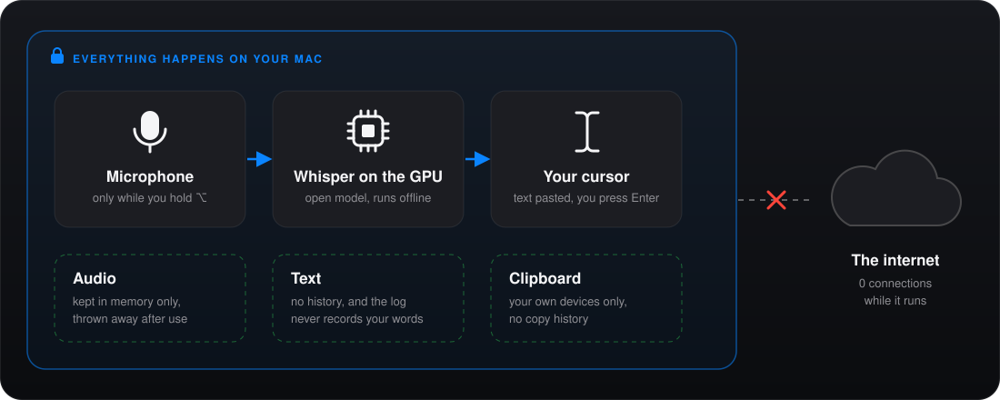

<p align="center">
  
</p>

<h1 align="center">VoiceFlow</h1>

<p align="center">
  <b>Private dictation you can verify.</b><br>
  Hold right ⌥ Option, speak, let go. Your words are typed wherever your cursor is,<br>
  transcribed by Whisper on your own Mac's GPU. No cloud, no account, no history.
</p>

<p align="center">
  Most dictation apps ask you to trust a privacy policy. VoiceFlow lets you
  <a href="#dont-trust-us-check-it-yourself">check</a>:<br>
  zero network connections while it runs, nothing you say is saved, and about 1,000 lines of code you can read.<br>
  Your sentence is on your clipboard too, so you can <a href="#paste-on-your-iphone-or-ipad">paste it on your iPhone or iPad</a>.
</p>

<p align="center">
  
  
  
  
  
</p>

---

## Private by design

Most dictation tools send your voice to someone else's servers to turn it into text.
VoiceFlow doesn't: the microphone, the speech model and the text all stay on your Mac.

<p align="center">
  
</p>

| | Typical cloud dictation | **VoiceFlow** |
|---|---|---|
| Where your voice is turned into text | On the provider's servers | **On your Mac's GPU** |
| Internet needed | Yes, for every sentence | **No**, only once to download the model |
| Account or sign-up | Usually | **None** |
| Copy of what you said | Kept by the provider, by their policy | **None, anywhere** |
| Cost | Often a monthly subscription | **Free, open source** |

### The privacy promises, and how each one is kept

| Promise | How |
|---|---|
| **Your voice is never saved.** | Audio is captured only while you hold the key, kept in memory, transcribed, then thrown away. No audio file is ever written. |
| **Your words are never saved.** | No history file. The log (`voiceflow.log`) records timings and length only, e.g. `4.3s audio -> 1.3s, 54 characters`. |
| **Nothing goes online.** | The model is loaded from the local `models/` folder and the app forces Hugging Face offline mode (`HF_HUB_OFFLINE=1`), so the running app makes **zero network connections**. |
| **Only your own devices get it.** | Each dictation is also copied to your clipboard so you can paste it on your iPhone or iPad. Apple's Universal Clipboard sends it from your Mac to your own devices (same Apple ID), encrypted by Apple, never through VoiceFlow or any third party (see [Paste on your iPhone or iPad](#paste-on-your-iphone-or-ipad)). Want it on this Mac only? Untick **Also copy to iPhone / iPad**. |
| **No copy history.** | The text goes straight to the clipboard and nowhere else. It is marked concealed ([nspasteboard.org](http://nspasteboard.org) convention), which Raycast, Alfred, Paste, Maccy and others respect by not saving it, so no clipboard history builds up. |
| **You stay in control.** | It pastes but never presses Enter, so nothing is sent until you have read it. |
| **You can read every line.** | About 1,000 lines of Python and C, MIT licence, no binaries except the open Whisper weights. |

### Don't trust us, check it yourself

<p align="center">
  
</p>

Run these on your own Mac while VoiceFlow is running:

```bash
# 1. Network: VoiceFlow should have no open connections (prints nothing)
lsof -nP -a -i -p "$(pgrep -f VoiceFlow/voiceflow.py)"

# 2. Works with the internet blocked: transcribe inside a no-network sandbox
sandbox-exec -p '(version 1)(allow default)(deny network*)' ./.venv/bin/python -c \
  "import numpy as np; from transcriber import transcribe_array; print(transcribe_array(np.zeros(16000, np.float32)) or 'ran offline')"

# 3. Storage: nothing you said is on disk
grep -c "characters" voiceflow.log   # counts dictations, shows no text
```

Or simply turn Wi-Fi off and keep dictating.

<details>
<summary><b>What the macOS permissions allow, honestly</b></summary>

- **Microphone**: macOS shows the orange mic dot while VoiceFlow listens: only while you hold
  the key, plus a 0.05 s check when the app starts.
- **Input Monitoring**: macOS has no "watch one key" permission, so the key listener receives
  key events in general. VoiceFlow only reacts to the right Option key (and to other keys only
  to cancel when you use an Option shortcut). It never records, stores or sends keystrokes:
  see `hotkey.py`, about 70 lines.
- **Accessibility**: used for one thing, sending ⌘V to paste. Without it, VoiceFlow leaves the
  text on the clipboard for you to paste (still hidden from clipboard managers).
- **Install** needs the internet once, to download the open Whisper model (1.6 GB) from
  Hugging Face. After that, nothing.

</details>

---

## What it lets you do

- **Dictate anywhere.** Hold right ⌥ Option, talk, release. The text is pasted at the cursor
  in any app. You still press Enter yourself, so nothing is sent by accident.
- **Fast.** About 1.3 s from releasing the key to text on screen for a typical prompt
  (measured on a base M2 MacBook with 8 GB of RAM).
- **Accurate with accents.** Uses Whisper large-v3-turbo, one of the best open speech
  models, tuned here for English. Tested with Indian-English voices.
- **Spells your jargon right.** Put names, products and technical words in `vocab.txt`
  and Whisper will use those spellings.
- **Cleans up the text.** Drops "um" and "uh", fixes spacing and capitalisation, and filters
  out the phantom phrases Whisper sometimes invents on silence ("Thank you.").
- **Stays out of your way.** Lives in the menu bar (no window, no Dock icon), can start at
  login, restarts itself if it crashes, and keeps your clipboard as it was.
- **Light.** Under 0.5% CPU while idle, about 1.2 GB on disk. The model (about 1 GB of memory) is
  dropped after 5 idle minutes, leaving about 0.1 GB, and is back before you finish your first sentence.
- **Soft sounds.** A gentle rising tone when it starts listening, a falling one when it is
  done. The tones are synthesised by a small script, so you can change them.

### Menu bar

| Icon | Meaning |
|---|---|
| 🎙… | Loading the model (a few seconds after start) |
| 🎙 | Ready |
| 🔴 | Listening (right Option is held) |
| ⏳ | Transcribing |
| 🎙⚠️ | A permission is missing (see [Permissions](#permissions)) |

The menu also has: **Edit vocabulary…**, **Also copy to iPhone / iPad**, **Start at login**
and **Quit VoiceFlow**.

### Paste on your iPhone or iPad

<p align="center">
  
</p>

Every dictation is typed at your cursor on the Mac **and** copied to your clipboard, so you
can paste the same sentence on your iPhone or iPad (tap and hold, **Paste**), or again on the
Mac with ⌘V. It works like any copy and paste, with no extra step.

- It uses Apple's Universal Clipboard: both devices signed in to the same Apple ID, with
  Bluetooth, Wi-Fi and Handoff turned on (iPhone: Settings > General > AirPlay & Continuity;
  Mac: System Settings > General > AirDrop & Handoff), and near each other.
- The transfer goes directly between your own devices and is encrypted by Apple. VoiceFlow
  itself still makes no network connections.
- Apple keeps it available on your other devices only for a short time (around two minutes).
- No history: it is flagged so clipboard managers don't save it. Like any copy, it replaces
  what was on your clipboard.
- On by default. Untick **Also copy to iPhone / iPad** in the menu to keep dictations on this
  Mac only (then the text is wiped from the clipboard right after pasting and your previous
  clipboard comes back). The choice is saved in `settings.json`.

---

## Requirements

- A Mac with **Apple Silicon** (M1, M2, M3, M4 or newer). Intel Macs are not supported (MLX needs Apple Silicon).
- macOS 13 Ventura or newer.
- **Python 3.12**, for example from [Homebrew](https://brew.sh): `brew install python@3.12`
- **Xcode Command Line Tools** (to build the small app launcher): `xcode-select --install`
- About **2.8 GB free disk** during install (1.6 GB model download + 0.84 GB compact copy + 0.35 GB Python packages).
  The installer deletes the 1.6 GB download when it is done, so VoiceFlow ends up at about 1.2 GB.
- 8 GB of RAM is enough.

---

## Install

```bash
# 1. Get the code
git clone https://github.com/theommishra-dev/VoiceFlow.git
cd VoiceFlow

# 2. Install (creates .venv, downloads and compresses the model, builds VoiceFlow.app)
./install.sh            # add --login to also start it automatically at every login
```

The installer:
1. checks that this is an Apple Silicon Mac with the Xcode tools and Python 3.12,
2. creates a private Python environment in `.venv/` (nothing is installed system-wide),
3. copies `vocab.example.txt` to your own `vocab.txt`,
4. downloads `mlx-community/whisper-large-v3-turbo` once (1.6 GB) and saves an
   8-bit copy in `models/whisper-turbo-q8` (0.84 GB, same accuracy in our tests, half the memory),
5. builds `VoiceFlow.app` in the project folder and opens it.

Everything VoiceFlow creates stays inside the project folder, apart from the model download
cache in `~/.cache/huggingface` and the optional Login Item.

### Permissions

The first time it runs, macOS asks for three permissions for **VoiceFlow**. Allow all three
in **System Settings > Privacy & Security**:

| Permission | Why |
|---|---|
| **Microphone** | to hear you while you hold the key |
| **Input Monitoring** | to notice the right Option key |
| **Accessibility** | to paste the text with ⌘V |

If you skip Accessibility, VoiceFlow still works but leaves the text on the clipboard for
you to paste yourself. The first line of `voiceflow.log` after each start shows which
permissions are on.

---

## Use

1. Click into any text box (for example the Claude Code prompt in Terminal).
2. **Hold the right ⌥ Option key** and speak.
3. Let go. The text appears about a second later. Check it, then press Enter.

Tips:
- Recordings shorter than 0.4 s are ignored, so a stray tap does nothing.
- Pressing another key while holding right Option (an Option shortcut such as ⌥E) cancels
  the recording, so your normal Option shortcuts keep working.
- Long prompts are fine: a 15-second sentence takes about 1.4 s.
- Start or restart it any time by double-clicking `VoiceFlow.app` in the project folder.

---

## Customise

| What | Where |
|---|---|
| Words Whisper should spell right | `vocab.txt` (one per line; applies to your next prompt, no restart) |
| Sound volume | `SOUND_VOLUME` in `voiceflow.py` |
| The sounds themselves | edit the tones in `make_sounds.py`, then `./.venv/bin/python make_sounds.py` |
| Minimum recording length, silence threshold | `MIN_SECONDS`, `SILENCE_PEAK` in `voiceflow.py` |
| The hotkey | `RIGHT_OPTION_KEYCODE` / `NX_DEVICERALTKEYMASK` in `hotkey.py` (e.g. right ⌘ is keycode 54, mask `0x10`) |
| Language | `language="en"` in `transcriber.py` (Whisper supports ~100 languages; `None` = auto-detect) |
| Smaller model (saves 0.4 GB RAM) | `./.venv/bin/python quantize_model.py 4`, then point `_Q8` in `transcriber.py` at `models/whisper-turbo-q4` |

After editing Python files, quit VoiceFlow from the menu bar and open `VoiceFlow.app` again.
You only need `./app_src/build_app.sh` if you change `app_src/launcher.c` or `app_src/Info.plist`
(macOS may then ask for the permissions again, because the app's signature changes).

---

## How it works

```
 hold right ⌥ ──► hotkey.py ──► recorder.py ──► release ──► transcriber.py ──► paster.py
 (Quartz event tap,   (mic, 16 kHz mono)          (Whisper large-v3-turbo,    (clipboard + ⌘V,
  listen-only)                                     8-bit, on the GPU via MLX)   then restores
                                                                                your clipboard)
```

| File | Role |
|---|---|
| `voiceflow.py` | Menu-bar app (rumps): states, sounds, login item |
| `hotkey.py` | Listen-only Quartz event tap for the right Option key; cancels on Option shortcuts |
| `recorder.py` | Microphone capture with Apple's AVAudioEngine, converted to 16 kHz mono; always uses the current default microphone |
| `transcriber.py` | Runs Whisper on a dedicated thread, cuts long dictations at pauses, cleans text, filters hallucinations, frees the model when idle |
| `slim.py` | Lets mlx-whisper load without numba and scipy (250 MB it only needs for word timestamps) |
| `paster.py` | Pastes via the clipboard and ⌘V, then puts your old clipboard back (text, images, files) |
| `app_src/launcher.c`, `Info.plist`, `build_app.sh` | A tiny native `VoiceFlow.app` that starts the Python app as its child, so macOS shows "VoiceFlow" in permission prompts, and restarts it if it crashes |
| `quantize_model.py` | Makes the 8-bit (or 4-bit) copy of the model from the Hugging Face download |
| `make_sounds.py` | Synthesises the soft start/stop tones in `sounds/` |
| `tests/` | Regression tests (`./.venv/bin/python -m unittest discover tests`) and a microphone stress test (`tests/stress_recorder.py`) |
| `docs/` | The animated images in this README (`hero.svg`, `privacy.svg`, `proof.svg`, `handoff.svg`), drawn by `docs/src/make_visuals.py` |
| `install.sh`, `uninstall.sh` | Set up and remove everything |
| `vocab.example.txt` | Starter vocabulary (your own `vocab.txt` is git-ignored) |

### Performance (base M2, 8 GB, macOS 27)

| | Value |
|---|---|
| Idle CPU | 0.1 to 0.3%, about 6 wake-ups per second |
| Memory | about 0.95 GB while you are dictating, about 0.12 GB after 5 idle minutes (the model is reloaded in about 0.3 s when you press the key) |
| Time per prompt | about 1.3 s for 4 to 15 s of speech, about 0.15 s of CPU (the rest is GPU) |
| Accuracy | 3.7% word error rate on 8 Indian-English test prompts; every error was formatting (5k vs five K, Summarize vs Summarise). fp16, 8-bit and 4-bit models scored the same |
| First prompt after start | 3 to 5 s while the GPU warms up |
| Disk | `.venv` 0.35 GB, `models/` 0.84 GB |
| Microphone reliability | 1,500 open/close cycles under full CPU load without a hang (`tests/stress_recorder.py`) |

---

## Troubleshooting

| Problem | Fix |
|---|---|
| 🎙⚠️ in the menu bar | Turn on VoiceFlow under Accessibility and Input Monitoring in System Settings > Privacy & Security, then reopen the app |
| Nothing happens when holding right Option | Check Input Monitoring; check `voiceflow.log`; make sure you hold the **right** Option key |
| Text appears on the clipboard but is not pasted | Accessibility is off for VoiceFlow |
| The first dictation is empty | macOS was showing the Microphone prompt; allow it and try again |
| A word is always wrong | Add it to `vocab.txt` |
| Right Option does nothing right after granting a permission | Fixed in the app (it re-installs the hotkey); if it still happens, quit and reopen VoiceFlow. For details, `touch .debug` in the project folder, reopen the app and read `voiceflow.log` |
| No 🎙 after double-clicking the app | Look at `voiceflow.log` in the project folder; run `./install.sh` again if `.venv` is missing |
| Permissions keep coming back after a rebuild | Expected after `build_app.sh`; remove the old VoiceFlow entries in System Settings and allow again |

---

## Uninstall

```bash
./uninstall.sh      # removes the login item, stops the app, deletes .venv, models and VoiceFlow.app
```

Then delete the project folder. The installer already deleted the 1.6 GB model download, unless
it was on your Mac before; in that case you can free it with
`rm -rf ~/.cache/huggingface/hub/models--mlx-community--whisper-large-v3-turbo`
(only if no other tool uses it). Permissions can be removed in System Settings > Privacy & Security.

---

## Fork it, change it

1. Click **Fork** on GitHub, then clone your fork and run `./install.sh`.
2. Change the bundle identifier in `app_src/Info.plist` and `app_src/build_app.sh`
   (`io.github.contactmishra.voiceflow`) to your own, for example `io.github.<you>.voiceflow`.
3. Ideas: a different hotkey, other languages or auto-detect, a "send Enter after paste"
   option, AI clean-up of the text, a waveform in the menu bar, an Intel build with
   whisper.cpp.

Pull requests and issues are welcome.

---

## Credits and licence

- [Whisper](https://github.com/openai/whisper) by OpenAI (MIT), the speech model.
- [MLX](https://github.com/ml-explore/mlx) and [mlx-whisper](https://github.com/ml-explore/mlx-examples/tree/main/whisper) by Apple (MIT); model weights from [mlx-community](https://huggingface.co/mlx-community/whisper-large-v3-turbo).
- [rumps](https://github.com/jaredks/rumps) (BSD), [PyObjC](https://github.com/ronaldoussoren/pyobjc) (MIT).
- The README graphics use [Instrument Sans](https://github.com/Instrument/instrument-sans) and [JetBrains Mono](https://github.com/JetBrains/JetBrainsMono) (both SIL Open Font License), drawn as outlines.

VoiceFlow itself is released under the [MIT licence](LICENSE).
Not affiliated with Voiceflow Inc., Wispr or OpenAI.
